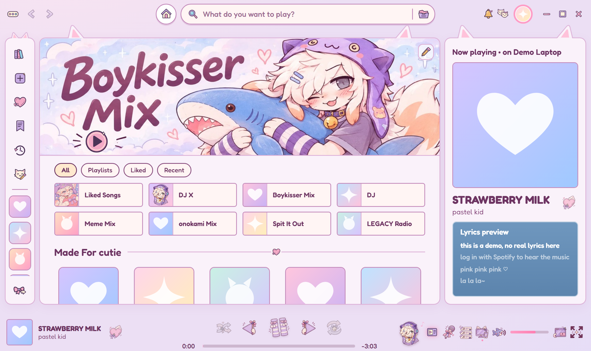

# ♡ femboy spotify ♡

A cute, pastel-pink Spotify client written in Rust. ✧



*(screenshot from demo mode: with your account you see your real playlists and album covers)*

## Features

- **built-in player**: music plays right in the app, no official Spotify app needed
  (one sign-in for everything)
- also a **Spotify Connect remote**: play on your phone, speaker or any device with the
  Spotify app (switch devices from the devices button)
- home screen with a big custom banner, shortcut tiles, and Spotify's own mixes
  (Daily Mixes, Release Radar, your top mixes...)
- **DJ X**: press the headphones buddy to start Spotify DJ, press again to switch it up
- liked songs, playlists, recently played, search
- now-playing panel with big cover art and **time-synced lyrics** (click a line to jump to it)
- queue, shuffle, repeat (all / one), seek, volume, add to liked songs
- custom banner: click ✎ on the banner (or the cat in the sidebar) to set your own picture and title
- frameless pastel window, keyboard shortcuts
- light on your computer: the cute animations run at 15-30 frames a second instead of the
  screen's refresh rate (idle CPU went from ~60 % of a core to under 10 %), and the hidden
  player runs in its own low-memory WebView without the graphics card (~860 MB with music playing)
- themes: light and dark (or follow Windows), and **Spotify (for normies)**: Spotify's own black and
  green look with its own Spotify-style icons (drawn for this app) and no ears, the custom banner still yours.
  The moon / sun button in the top bar
- bonus: a terminal version (`femboy-spotify-tui`) for terminal lovers

## Requirements

- **Spotify Premium** account
- [Rust](https://rustup.rs) 1.85+ to build from source
- Windows 10/11 (uses WebView2, already installed on Windows 11)
- Linux: `sudo apt install libwebkit2gtk-4.1-dev libasound2-dev pkg-config build-essential`

## Install & run

**Windows:** download **Femboy.Spotify_x.y.z_x64-setup.exe** from the
[latest release](https://github.com/ScaraKazuha/femboy-spotify/releases/latest) and run it.
The app updates itself after that (watch the bell in the top bar).

From source:

```sh
git clone https://github.com/ScaraKazuha/femboy-spotify
cd femboy-spotify
rustup target add wasm32-unknown-unknown   # the interface is Rust compiled to WebAssembly
cargo install trunk tauri-cli --locked
cargo tauri dev        # or: cargo tauri build (makes the installer)
```

On first launch, click **sign in with Spotify**. A Spotify sign-in window opens inside the app.
After that, your login is saved (in your OS cache dir, `femboy-spotify/`), so next time the app starts right away.
To log out, click the ribbon 🎀 at the bottom of the sidebar.

### How does it play music?

Spotify currently refuses to give audio decryption keys to [librespot](https://github.com/librespot-org/librespot)
(the open-source library every third-party client uses, see
[librespot#1649](https://github.com/librespot-org/librespot/issues/1649)).
So the app carries Spotify's own web player in a hidden window (WebView2 has Edge's DRM built in).
It shows up as a Spotify Connect device, and the app controls it, or any of your other devices,
like the official "devices" menu does. One sign-in covers both the app and the player.
The terminal version still tries local playback with librespot and is affected by that issue.

No developer account or Client ID is needed: your profile, playlists, liked songs,
search and lyrics come from the same internal Spotify services the official app uses
(through librespot), not from the rate-limited public Web API.
"Recently played" is the history of what you played in femboy spotify.

Terminal version:

```sh
cargo run --release --bin femboy-spotify-tui
```

## Keys

| key | action |
|---|---|
| `space` | play / pause |
| `←` / `→` | seek 10 s |
| `↑` / `↓` | volume |
| `n` / `p` | next / previous |
| `/` or `ctrl+L` | search |
| `alt+←` / `alt+→` | back / forward |

## Hacking on the UI

The interface is written in Rust too: [`ui/`](ui) is a small crate compiled to WebAssembly
(wasm-bindgen + web-sys) that runs in the app's WebView, with `index.html` and `style.css` around it.
Run `trunk serve` in `ui/` and open http://127.0.0.1:8080 to get **demo mode** with fake data,
no Spotify login needed (`?shot` starts a song, `?theme=dark`, `?update`, `?noplayer`).

- `ui/src/app.rs` what the interface does (pages, playback, devices, playlists, lyrics...)
- `ui/src/views.rs` the HTML of each page, `ui/src/menu.rs` the pop-up menus, `ui/src/events.rs` the buttons
- `ui/src/demo.rs` the pretend backend for demo mode

The app's side lives in `src/`: `auth.rs` (login), `api.rs` (Spotify's internal services + lyrics),
`remote.rs` (Spotify Connect), `main.rs` (Tauri commands, the built-in player window).

## По-русски

Милый пастельно-розовый клиент Spotify на Rust: обложки, тексты песен, очередь, свой баннер.
Нужен Spotify Premium. Скачайте установщик из релизов (или соберите: `cargo tauri build`). При первом запуске нажмите
«sign in with Spotify», внутри приложения откроется вход в Spotify. Интерфейс тоже на Rust (WebAssembly).

## Disclaimer

This is an unofficial hobby project, not affiliated with or endorsed by Spotify.
It uses librespot, an open-source reverse-engineered client library; using third-party
clients may be against Spotify's Terms of Service. Use at your own risk.

## License

MIT
